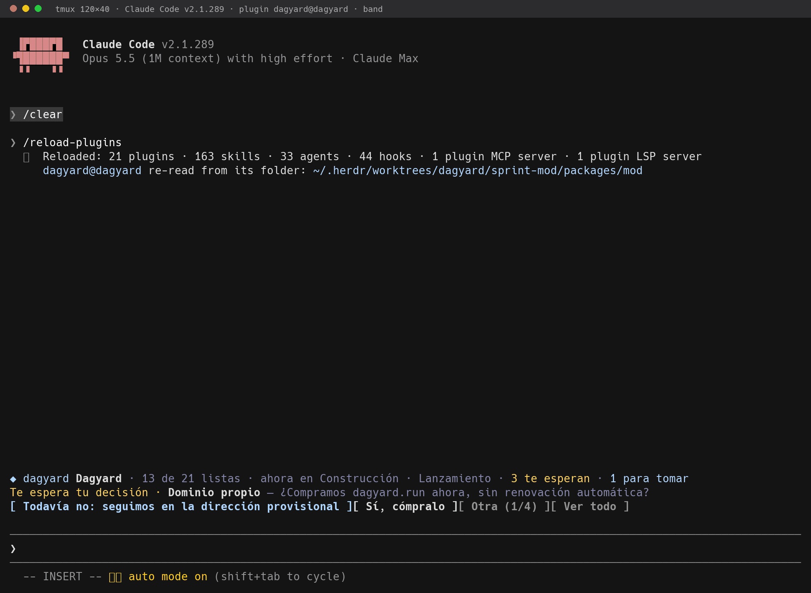
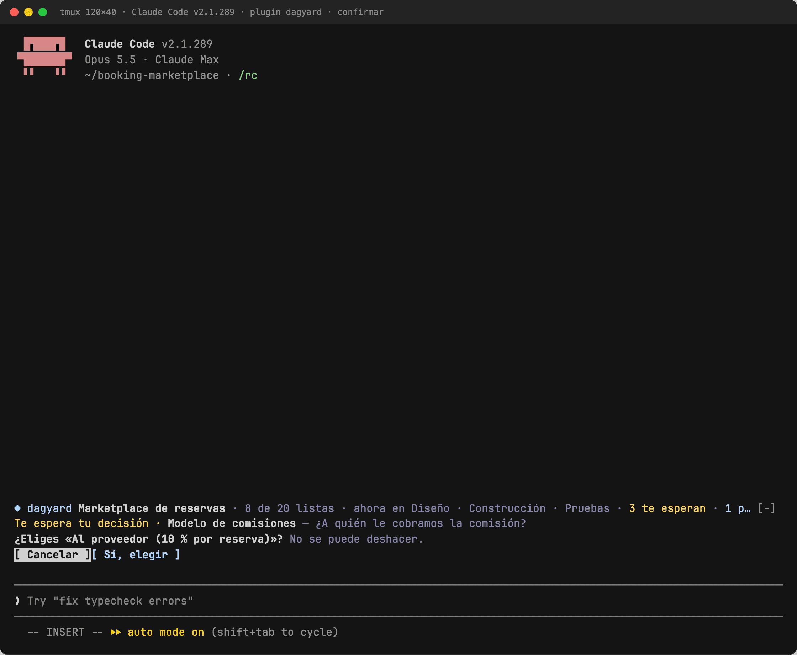
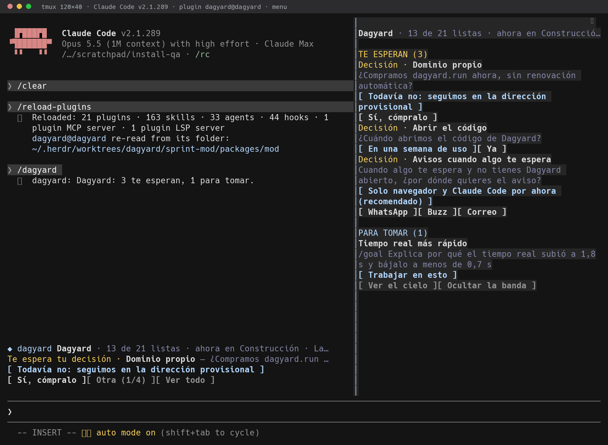
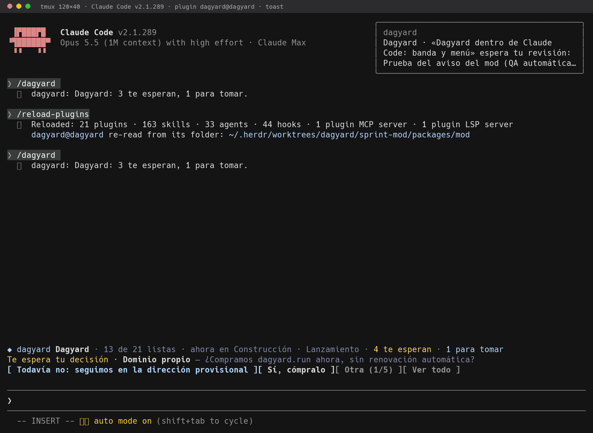

# Dagyard en Claude Code

Una banda sobre el prompt con lo que le toca a esta sesión, un menú para responderlo todo de corrido
y un aviso cuando algo nuevo te espera. Todo lo que haces aquí se ve al instante en el cielo (la web),
porque escribe en la misma API.

- **Te espera**: una decisión o una revisión se responden desde la banda o el menú, en dos pasos:
  marcas la opción y confirmas con «Sí, elegir» («Cancelar» la deja como estaba). Resolver no se
  deshace, así que ninguna tecla suelta elige: las opciones no tienen atajo y un dígito en el prompt
  vacío se queda en el prompt. Un acceso se da en el cielo: su valor nunca pasa por la terminal.
  «Darlo en el cielo» abre esa tarea con su ficha.
- **Ver el cielo**: abre el proyecto del repo (o la tarea en la que estás trabajando).
- **Para tomar**: lo pendiente, sin equipo y con todo lo que necesita ya listo. «Trabajar en esto» la
  arranca y fija su `/goal` en la sesión. Como todo lo que escribe («Hecha», «Soltarla»), pide confirmar
  y no tiene atajo; los atajos que quedan solo miran (`s` otra, `m` ver todo, `o` el cielo).
- **Menú** (`/dagyard` o «Ver todo»): todo lo anterior a la vez.
- **Aviso**: cuando se abre algo nuevo que te espera, un toast en ≤20 s.






## Instalación (un paso)

Sin clonar nada:

```bash
claude plugin marketplace add cofoundy/dagyard && claude plugin install dagyard@dagyard
```

Desde un clon del repo, en su raíz (queda leyendo esa carpeta: un `git pull` lo actualiza; en una sesión
abierta, `/reload-plugins`):

```bash
claude plugin marketplace add "$PWD" && claude plugin install dagyard@dagyard
```

Queda instalado para todas tus sesiones. Para probarlo sin instalar: `claude --plugin-dir "$PWD/packages/mod"`.

Quitarlo: `claude plugin uninstall dagyard@dagyard && claude plugin marketplace remove dagyard`.

### El CLI viene incluido

Mientras el plugin está activo, `dagyard` está en el PATH de los comandos que corre el agente (`bin/dagyard`,
el bundle de `packages/cli`, sin dependencias, Node ≥22). Se llama con el comando primero y las opciones
después: `dagyard msg pagos "listo el cobro" --project mi-proyecto`.

### La skill del protocolo

`skills/protocol/SKILL.md` (`dagyard:protocol`) le enseña a cualquier agente a trabajar a la vista: arrancar su nodo, dejar un
mensaje en cada hito, pedir lo que es de una persona con `block`, hacer nacer cada nodo de otro o de un
objetivo con su porqué, anotar lo que pidió una persona con sus palabras y cerrar con motivo. Carga sola cuando
el repo tiene `.dagyard.json` o cuando el pedido habla de Dagyard.

### El canal (opcional, apagado por defecto)

Un segundo plugin del mismo marketplace, `dagyard-channel`, lleva a la sesión la respuesta del dueño a tu
bloqueante sin que el agente espere con `dagyard wait`, y le da la tool `reply` para dejar un mensaje en su
nodo. Instalarlo es la decisión: corre un proceso MCP por sesión, así que solo lo instala quien lo usa.

```bash
claude plugin install dagyard-channel@dagyard
claude --dangerously-load-development-channels plugin:dagyard-channel@dagyard
```

El flag hace falta porque es un canal propio, fuera de la lista de canales aprobados (research preview);
Claude Code pide confirmarlo al arrancar. Lee el proyecto igual que el CLI (entorno, `.dagyard.json`,
`~/.config/dagyard`). Detalle: [`packages/channel/README.md`](../channel/README.md).

## A qué proyecto mira

El primero que encuentre, en este orden:

1. `DAGYARD_PROJECT` (y `DAGYARD_URL`) en el entorno;
2. el `.dagyard.json` más cercano subiendo desde la carpeta de la sesión, p. ej.
   `{"project": "dagyard", "url": "https://dagyard.cofoundy-dev.workers.dev"}` (`url` es opcional);
3. `~/.config/dagyard/project` (y `url`).

Sin proyecto, el mod calla: ni banda ni llamadas; `/dagyard` dice cómo enlazar el repo. Así puede
quedar instalado en todas las sesiones sin ensuciar los repos que no usan Dagyard. El servidor, si
nada lo dice, es `https://dagyard.cofoundy-dev.workers.dev`.

Las claves salen de `~/.config/dagyard/agent-key` (leer y tomar tareas) y `owner-token` (responder lo
que te espera). Nunca se imprimen.

## Idioma

Habla inglés; español si el entorno de Claude Code lo pide (`LC_ALL` > `LC_MESSAGES` > `LANG`, con el
mismo criterio que el CLI). Lo que escribe una persona (títulos, preguntas, opciones) no se traduce, y
los atajos de teclado son los mismos en los dos idiomas.

## Desarrollo

```bash
claude plugin validate packages/mod   # manifiesto y módulo, como los lee el motor
claude plugin test packages/mod       # hooks/*.test.ts(x)
node scripts/plugin-bundle.mjs        # tras cambiar packages/cli o packages/channel: regenera los bin/
```

Los `bin/` de los dos plugins van commiteados (un plugin instalado desde git no corre build); el CI corre
`node scripts/plugin-bundle.mjs --check` y falla si no son el build de hoy.

`hooks/view.ts` calcula la vista desde el snapshot (puro); `hooks/register.tsx` es todo lo que toca
el motor: la banda (`AbovePrompt`), el menú (`Pane` `dagyard-menu`), el comando y el sondeo cada
10 s. Los tipos del motor los escribe Claude Code en `.claude-plugin/types/` al cargar el mod
(ignorados por git); con ellos, `npx tsc -p packages/mod` revisa los tipos.
